  

  

<h2>🌙 About Vaelo</h2>

Vaelo is a small independent studio. We make **Roblox games**, **desktop tools** and **interfaces** that feel good to use, and we sweat the small stuff.

<h2 align="center">🛠️ What We Build</h2>

<table align="center">
  <tr>
    <td align="center" width="33%" valign="top">
      <h3>🎮 Games</h3>
      Roblox experiences and systems, built in Lua
    </td>
    <td align="center" width="33%" valign="top">
      <h3>🖥️ Tools</h3>
      Desktop utilities in Rust, C# and Electron
    </td>
    <td align="center" width="33%" valign="top">
      <h3>🎨 Interfaces</h3>
      Designed in Figma, built down to the pixel
    </td>
  </tr>
</table>

<h2 align="center">🚧 Projects</h2>

  First releases are in the works. 
  <b>Watch this org</b> to see them land.

<h2 align="center">👥 Team</h2>

<table align="center">
  <tr>
    <td align="center">
      <a href="https://github.com/Audriean">
         
        <b>Audriean</b>
      </a> 
      Founder · Dev &amp; Design
    </td>
  </tr>
</table>

<h2 align="center">🧰 Our Stack</h2>

  

<h2 align="center">💬 Get in Touch</h2>

  
  

 

  

